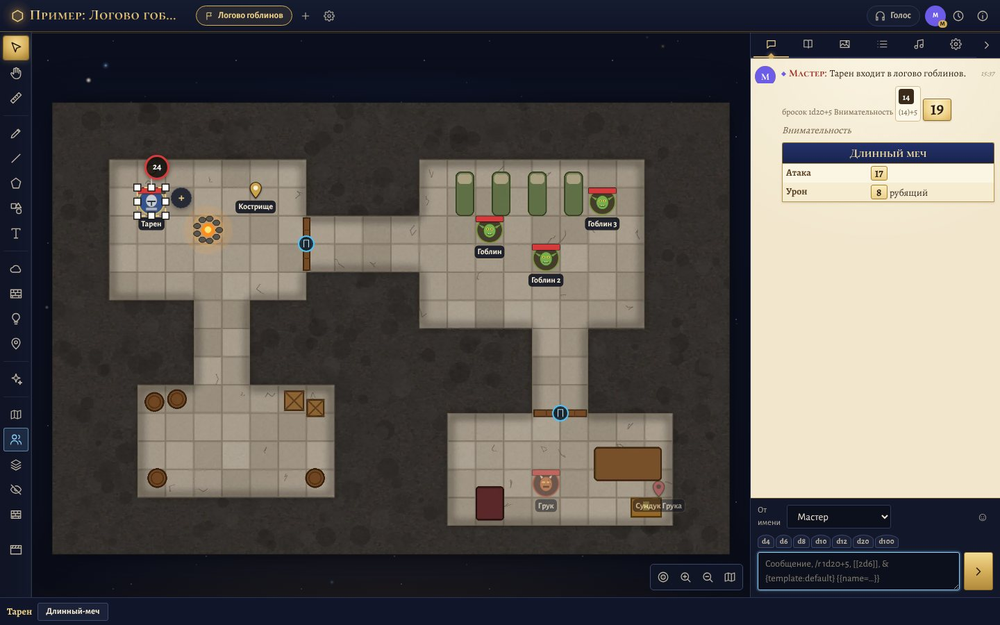

  

<h1 align="center">Taverna</h1>

  A self-hosted virtual tabletop for role-playing games, in the spirit of Roll20 — shipped as a single program. 
  Maps with fog of war and dynamic lighting, tokens, dice, Roll20 character sheets, voice and video.

  <a href="../../releases/latest"><b>Download</b></a> ·
  <a href="README.md">Русский</a>

> **The interface is in Russian.** Taverna was made for a Russian-speaking group; the code, comments and documentation
> are in Russian too. Translations are welcome.

**Taverna** is a game server that runs on your own computer or on your own server on the internet. The game master
starts the program; players join from a browser on a computer or a phone, with nothing to install. Tables,
characters, maps and music stay with you.

- **One program** for Windows and Linux: the server, the web app and the character sheets in a single file.
  On a Linux server, one command installs a service and gets an HTTPS certificate from Let's Encrypt.
- **Roll20 character sheets** with their formulas, sheet workers and roll templates: D&D 5E, Taverna's own
  D&D 2024 sheet, Cyberpunk RED, Warhammer Fantasy 4e, Wrath & Glory — and any other sheet from the Roll20
  character sheets repository.
- **Maps**: square and hex grids, fog of war, dynamic lighting with walls and doors, area templates, effects,
  weather, traps.
- **Dice**: the full Roll20 roll syntax, 3D dice rolling across the table, damage and healing with one click.
- **Bestiary**: 330 SRD 5.2.1 monsters straight onto the map, with stat blocks and attack buttons; load your own
  from GitHub (Open5e-style JSON or the SRD in Markdown).
- **Voice and video** between players, cinematic tricks for the GM, session summaries, and a low-power mode
  for weak or hot laptops.

## Running it

- **Windows 10/11:** download `Taverna-<version>-setup.exe` from the [releases page](../../releases/latest) and run it.
  The first account to register becomes the administrator.
- **Linux server:** unpack `taverna-<version>-linux-x64.tar.xz` and run `sudo ./taverna-linux-x64 install`.
- **From source** (Node.js 22.13+): `npm ci && npm run build && npm start`, then open http://localhost:3000.
  Building the single-file programs and the Windows installer: `npm run build:exe` on Linux or WSL with NSIS installed.

## Who made it

Taverna's code was written by **Claude**, an AI model by Anthropic, following the ideas, direction and testing of
the owner of this repository, who maintains the project.

## License

Taverna is free software under the **GNU AGPL-3.0** (see [LICENSE](LICENSE)): you may use, study, change and share it,
including commercially, as long as modified versions stay open under the same license — including versions you run
on a server for others. The license covers the code, not the name: please publish your own versions under a different name.

Third-party components and their licenses are listed in [THIRD_PARTY_NOTICES.md](THIRD_PARTY_NOTICES.md).
SRD 5.2 / 5.2.1 material © Wizards of the Coast LLC, CC BY 4.0. Roll20 is a trademark of Roll20, LLC; Dungeons & Dragons
and D&D are trademarks of Wizards of the Coast; Cyberpunk RED belongs to R. Talsorian Games; Warhammer to Games Workshop.
This project is not affiliated with or endorsed by any of them.
