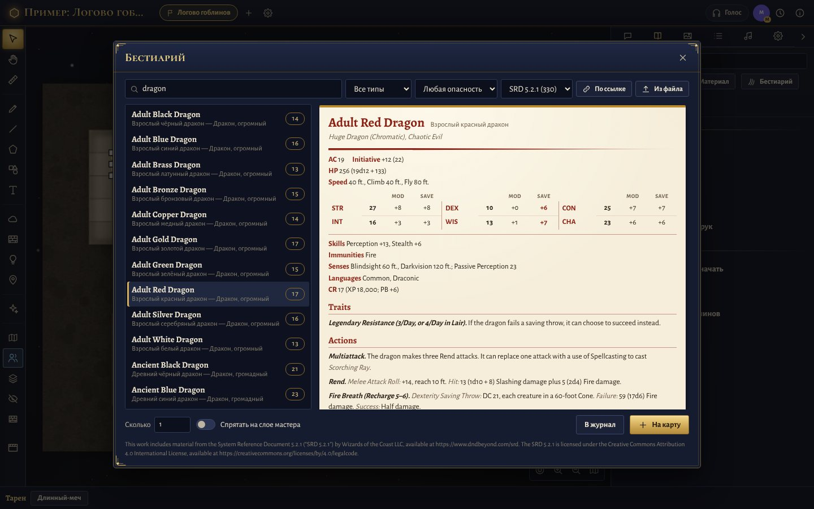
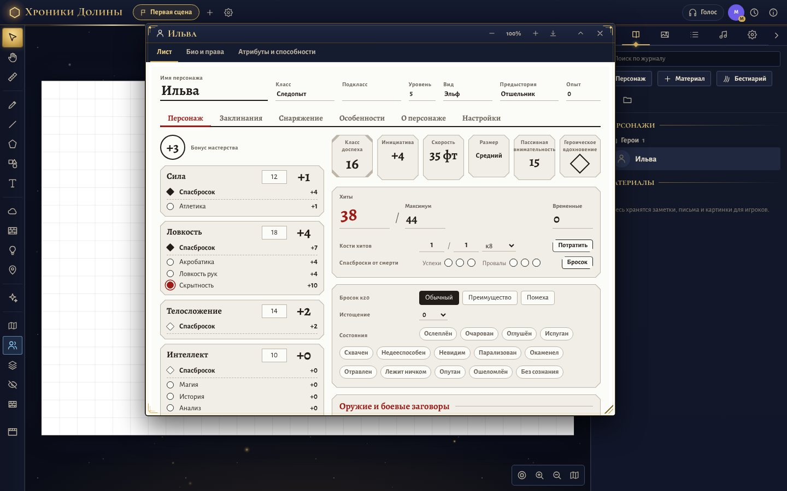
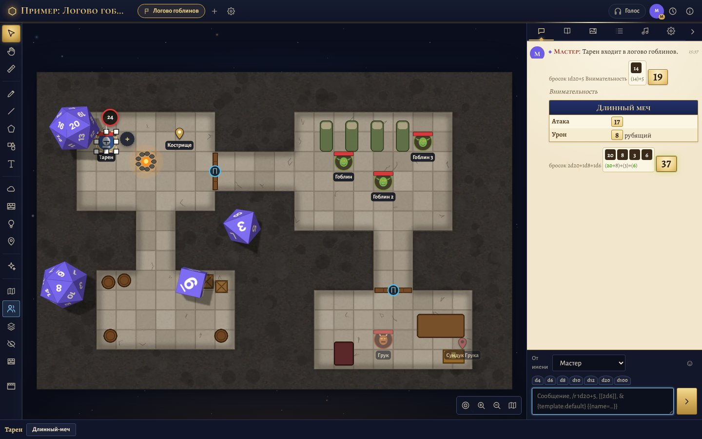

<p align="center">
  
</p>

<h1 align="center">Таверна</h1>

<p align="center">
  Свой виртуальный стол для настольных ролевых игр — в духе Roll20, одной программой.<br>
  Карта с туманом войны и светом, токены, кубики, листы персонажей Roll20, голос и видео.
</p>

<p align="center">
  <a href="../../releases/latest"><b>Скачать</b></a> ·
  <a href="#как-запустить">Как запустить</a> ·
  <a href="#возможности">Возможности</a> ·
  <a href="README.en.md">English</a>
</p>


**Таверна** — сервер для игр по сети, который работает на вашем компьютере или на своём сервере в интернете.
Мастер запускает программу, игроки заходят из браузера — с компьютера или с телефона, ничего не устанавливая.
Столы, персонажи, карты и музыка хранятся у вас.

- **Одна программа** для Windows и Linux: внутри сервер, сайт и листы персонажей. На сервер в интернете — одна команда, сертификат HTTPS получается сам.
- **Листы персонажей Roll20** — с их формулами, скриптами и шаблонами бросков: D&D 5E, свой лист D&D 2024, Cyberpunk RED, Warhammer Fantasy 4e, Wrath & Glory — и любой другой из репозитория листов Roll20.
- **Карта**: квадратная и шестиугольная сетка, туман войны, динамический свет со стенами и дверями, шаблоны областей, эффекты, погода, ловушки.
- **Кубики**: полный синтаксис бросков Roll20, объёмные кубики катятся по столу, урон и лечение — щелчком по числу в чате.
- **Бестиарий**: 330 монстров SRD 5.2.1 сразу на карту — со статблоком и кнопками атак; свои — по ссылке с GitHub.
- **Голос и видео** между игроками, кинотрюки мастера, итоги вечера и «режим чайника» для слабых компьютеров.

| | |
|---|---|
|  |  |
| Бестиарий: монстры SRD 5.2.1 со статблоком | Свой лист D&D 2024 |

## Как запустить

**На своём компьютере (Windows 10/11).** Скачайте `Taverna-<версия>-setup.exe` со страницы [выпусков](../../releases/latest)
и запустите. Windows может предупредить «Система Windows защитила ваш компьютер» — «Подробнее» → «Выполнить в любом случае»
(у программы нет платной цифровой подписи). Таверна откроет браузер; первый зарегистрированный — администратор.
Игроки в вашей сети заходят по адресу из окна сервера, с телефона — по QR-коду (главное меню → «Телефон»).
Подробности, переносная версия и обновление — в разделе [«Одна программа»](#одна-программа--без-консоли-и-docker).

**На сервере в интернете (Linux).** Скачайте `taverna-<версия>-linux-x64.tar.xz`, распакуйте и выполните
`sudo ./taverna-linux-x64 install` — программа спросит домен и e-mail, поставит службу и получит сертификат.
Есть и [вариант с Docker](#установка-на-vps-через-docker).

**Из исходников** (Node.js 22.13+): `npm ci && npm run build && npm start` — стол на http://localhost:3000.
Как собрать программу и установщик — в разделе [«Сборка программы»](#сборка-программы), как участвовать — в [CONTRIBUTING.md](CONTRIBUTING.md).

## Возможности

**Аккаунты и столы**
- Регистрация и вход; первый зарегистрированный пользователь становится администратором.
- Стол (игра) создаётся мастером, игроки входят по коду или по ссылке-приглашению (`/join/КОД` — после входа сразу за столом). Код можно перевыпустить, игрока — исключить или заблокировать.
- Роли: мастер и игрок; можно назначить нескольких мастеров. Экспорт и импорт стола целиком (JSON).
- **Дата следующей игры**: мастер указывает её в настройках стола, все участники видят её в лобби («завтра в 19:00») и одним щелчком добавляют в свой календарь (файл `.ics`).
- **Пример стола** одной кнопкой в лобби: подземелье «Логово гоблинов» с картой, стенами и дверями, светом, героем, гоблинами, памяткой и таблицей находок — чтобы сразу попробовать всё.
- За новым столом мастера встречает короткий список «С чего начать»: положить карту, создать персонажа, позвать игроков, включить туман или свет. Сделанные пункты отмечаются сами.

**Доска**
- Сцены (страницы) с квадратной или шестиугольной сеткой, единицами измерения и правилами диагоналей.
- Слои: карта, объекты/токены, передний план, слой мастера (невидим игрокам), стены.
- Картинки, анимированные GIF и видео (mp4/webm) как фон и как объекты; перетаскивание файлов прямо на доску. Карту с нарисованной сеткой можно подогнать под сетку сцены (правая кнопка → «Подогнать под сетку…»).
- Токены с уникальным ID; привязка к персонажу; права управления выдаются мастером конкретным игрокам — в настройках токена или правой кнопкой → «Отдать игроку».
- **Сцепка токенов**: «Сцепка → Прицепить к токену…» — пассажир едет вместе с транспортом (повозка, корабль, всадник на коне), повторяет его поворот; если передвинуть пассажира самого, он отцепляется.
- **Макросы токена**: свои кнопки у каждого токена (вкладка «Макросы» в его настройках) — появляются внизу стола, когда токен выделен; макрос из коллекции или кнопку броска из листа можно просто перетащить на токен.
- **Способы перемещения**: как виден ход токена — сразу (видно, как тянут), плавно, по клеткам шагами, телепортом или сквозь огонь; общий выбор в настройках стола и свой у каждого токена. С анимацией токен тянут полупрозрачным «призраком», а после отпускания он идёт выбранным способом у всех, и у того, кто тянул, — по пути со всеми поворотами (пробел во время перетаскивания).
- Доска остаётся чёткой при любом приближении: подписи, маркеры и линии перерисовываются в текущем масштабе, как только камера замирает.
- Любое число баров любого цвета; бар можно связать с атрибутом листа (значение синхронизируется в обе стороны), задать видимость для всех/владельцев/мастера. Над выделенным токеном — кружки баров, как в Roll20: щёлкнуть и ввести `12`, `-7` или `+3`. Положение баров (над, сверху, снизу, под токеном) — общее для стола или своё у токена.
- Фигуры-токены (прямоугольник, эллипс, ромб, шестиугольник, звезда, стрелка и др.) с растяжением и поворотом; рисование, линии, многоугольники, текст.
- Статус-маркеры (цветные и состояния D&D), ауры, оттенок, эффекты (свечение, пульсация, призрачность, размытие и др.). Рядом с выделенным токеном — его маркеры: щелчок — число на маркере (уровень, стопки) и срок в раундах, «+» — поставить любой.
- **Свои маркеры и эффекты** (в духе Dynamic Active Effects из Foundry): своя картинка или символ, изменения атрибутов персонажа или полос токена («КД +2», «скорость −5 × уровень»). Пока маркер стоит — значения изменены, сняли или вышел срок — вернулись; о конце эффекта мастеру приходит сообщение.
  - **Формулы** в значениях: `13 + @{dexterity_mod}`, `2d4 + 4` (кубики бросает сервер, бросок виден в чате), `@{маркер}` — число на маркере; «дописать к тексту» добавляет кубик к полю-формуле листа (`1d4` к «К атакам» у «Благословения»).
  - **Сам токен**: свет, тёмное зрение, размер (растёт от центра), прозрачность, невидимость — и всё возвращается, когда эффект снят.
  - **Сроки**: раунды, минуты, часы или «до начала / до конца следующего хода цели» (как «Щит»); **концентрация** — у наложившего появляется маркер «Концентрация», сняли его или он взял другое заклинание с концентрацией — эффект кончается у всех целей, а при уроне мастеру напомнят о спасброске.
  - **Каждый ход**: урон или лечение формулой, спасбросок, чтобы закончить эффект, сообщение в чат («Горение», «Яд», «Регенерация»).
  - **Готовые эффекты** одной кнопкой: «Благословение», «Порча», «Щит», «Щит веры», «Доспехи мага», «Ускорение», «Замедление», «Увеличение/Уменьшение», «Ложная жизнь», «Ярость», «Свет», «Тёмное зрение», «Невидимость», «Размытый образ», «Уклонение», «Полёт», «Горение», «Кровотечение», «Яд», «Регенерация».
  - Наложить: «+» у выделенного токена, **кнопка «Наложить» под броском заклинания** в чате (по названию или другому названию эффекта), меню числа броска или макрос `/effect Название [--target] [--remove]`. На чужие токены эффект ставит мастер (просьба уходит ему сама; мастер может это запретить).
- Туман войны: ручной (открыть/скрыть прямоугольником, эллипсом, многоугольником, кистью) и **динамический свет**: стены, двери (открываются кликом), окна, источники света с ярким/тусклым радиусом, тёмное зрение, конус обзора, режим исследования (запоминание увиденного), запрет прохода сквозь стены. **У каждого игрока своё поле зрения** — только глазами его токенов (поделиться обзором можно «Общим обзором» у токена или «Общим обзором отряда» на сцене). Чужие токены вне поля зрения игрока скрыты целиком, двери видны, только когда их видно; мастер может посмотреть глазами всех игроков или конкретного игрока — скрытое от них станет полупрозрачным.
- Эффекты частиц (взрыв, огонь, магия, кровь и т. д.) и погода (дождь, снег, туман) на сцене.
- **Метки на карте**: подпись, заметка для игроков и ссылка на материал из журнала; игроки открывают метку щелчком, метки на слое мастера видны только ему.
- Линейка с промежуточными точками (видна всем по желанию) и **шаблоны областей**: круг, конус (53° по D&D или свой угол), куб, луч — с подсветкой клеток; область можно оставить на карте.
- Пинг (долгое нажатие; Shift — перенести камеру игроков), трекер инициативы с раундами и оповещением «Ваш ход», отмена/повтор, копирование/вставка.
- **Кинотрюки мастера** — кнопка с хлопушкой на панели инструментов: титры на весь стол (заголовок, подзаголовок, картинка), голос рассказчика субтитрами с кинополосами, затемнение (держится и для тех, кто зайдёт позже; мастер видит стол сквозь него), кинополосы, тряска и землетрясение, белая, красная и золотая вспышка, плавный пролёт камер игроков к виду мастера. То же командами `/титры`, `/рассказ`, `/затемнение`, `/кино`, `/тряска`, `/вспышка`.
- **Ловушки**: правый щелчок по карте — «Поставить ловушку здесь» или «Сделать ловушкой» у любой фигуры или картинки. Ловушка срабатывает, когда ход сделан: токен отпустили на ней или провели через неё (весь путь от начала перетаскивания, с поворотами); пока токен только тянут и примеряются, она молчит, а если его вернули назад — не срабатывает вовсе. Может остановить токен на себе, написать описание в чат (`{name}` — кто попался), бросить урон и сразу снять его с хитов (с отменой), напомнить о спасброске, тряхнуть экран, вспыхнуть, показать спецэффект, после срабатывания открыться игрокам. Срабатывает на токены игроков или на любые, один раз или каждый раз, в том числе когда токен ведёт мастер (это можно выключить). Если ловушка пропустила токен из-за своих настроек, мастеру приходит подсказка с кнопкой «Настроить». Мастер видит ловушки красной пунктирной рамкой со значком, разряженные — серой; игроки не получают даже их настроек.
- **Бестиарий мастера** — кнопка «Бестиарий» в журнале: 330 монстров и зверей SRD 5.2.1 (D&D 2024) с поиском по-английски и по-русски, фильтрами по типу и опасности и статблоком как в книге. «На карту» ставит сразу нужное число (можно спрятать на слое мастера): токены по размеру существа (большой — 2×2, огромный — 3×3), у каждой копии свои хиты и номер. Монстр становится персонажем в папке «Монстры» с вкладкой «Статблок» (щелчок по действию — атака и урон в чат), кнопками токена «Инициатива», «Спасбросок» и всеми атаками, а на листе D&D 2024 — с заполненными характеристиками, спасбросками и навыками. Броски монстров можно сделать видимыми только мастеру. Свои монстры — **по ссылке прямо с GitHub** (gist с JSON в духе Open5e, например [монстры SRD 5.2.1](https://gist.github.com/krisimmig/f4b7d2a30cadd2d94107f5533ba9c85c), репозиторий [Markdown SRD](https://github.com/downfallx/dnd-5e-srd-markdown) или ссылка на файл) или из файла `.json` / `.md`.
- В порядке ходов — свои записи с формулой (например, кубик эскалации «+1» каждый раунд) и **инициатива картами** для Savage Worlds и Deadlands: колода на 54 карты с джокерами, ходят от старшей карты.
- Работает на планшетах и телефонах: щипок — масштаб, палец — сдвиг карты, боковая панель сворачивается.
- **Режим чайника** — для слабых и горячих компьютеров: кнопка в главном меню (за столом — «Настройки» → «Для меня»). Кубики плоские, оформление без анимации, без эффектов бросков в чате, погода и спецэффекты — реже и с меньшим числом частиц, эффекты токенов — без движения; всё остальное работает как обычно. Настройка — на этом устройстве, сразу во всех открытых вкладках. И без него Таверна бережёт видеокарту: искры и звёзды «Фэнтези», кольцо хода и горение токенов меняются ступеньками 10–15 раз в секунду, а не на каждом кадре экрана (на игровом ноутбуке — 144 раза), погода рисуется 30 кадров в секунду, кнопки дверей не пересоздаются, пока двигают карту.

**Чат и броски**



- Полный синтаксис бросков Roll20: `/r 4d6k3`, `2d20kh1+5`, взрывы `!`, `!!`, `!p`, переброс `r`/`ro`, успехи `>8`, `cs/cf`, сортировка, совпадения, группы `{...}kh1`, fudge `dF`, таблицы `1t[Сокровища]`.
- Inline-броски `[[...]]` с подсказкой, шаблоны бросков `&{template:...}`, `/w`, `/gr`, `/em`, `/ooc`, `/desc`, `/as`, `/emas`, `/fx`, `&{tracker}`.
- Макросы, кнопки на панели макросов (туда же можно перетащить кнопку броска прямо из листа), таблицы случайных событий, способности персонажей `%{...}`, атрибуты `@{selected|...}`, `@{target|...}`, запросы `?{...}`.
- Журнал чата сохраняется одним HTML-файлом (вкладка «Настройки»).
- **Урон и лечение в один щелчок**: выделите токены и щёлкните по числу броска в чате — «урон», «половина», «двойной» или «лечение». Хиты меняются на полосе хитов (её Таверна находит сама или по настройке стола), временные хиты принимают урон первыми, над токенами у всех всплывает число, в уведомлении есть «Отменить».
- **Кубики катятся по столу** (three.js и физика cannon-es): d4–d20, d100 двумя d10, Fate; сверху выпадает ровно то число, что посчитал сервер. Можно переключить на плоские или выключить — «Настройки» → «Для меня».
- **Свои кубики**: 19 наборов — цвет игрока, слоновая кость, пергамент, морёный дуб, мрамор, малахит, обсидиан, золото, серебро, медь с патиной, лёд, рубин, изумруд, аметист, лава (раскалённые трещины светятся), звёздная ночь, неон, яд, кровь. Набор хранится в аккаунте, его видят все за столом; «Бросить пробный» катит полный набор только у себя. Натуральная 20 на d20 — золотая вспышка «Крит!», единица — бурый дым «Провал!».
- **Бросок прилетает в чат с эффектом** — каждый выбирает свой: листопад, искры, угли, иней, молния, дым, лепестки, звёздная пыль, чернила, брызги, руны, глитч (или «по оформлению стола»: угли, руны, глитч). На натуральной 20 эффект богаче и с золотой волной. Эффекты можно выключить у себя.
- **Реакции**: 😂 🔥 😱 👍 ❤️ 👏 💀 🎲 🤔 🍺 под любым сообщением (видно, кто поставил) и всплывающие над своим токеном — кнопка ☺ у поля ввода.
- **Итоги вечера** — `/итоги` или кнопка в настройках мастера: карточка в чате со статистикой бросков и наградами («Любимец удачи», «Проклятый кубик», «Золотая рука», «Чёрная полоса», «Главный калибр», «Душа компании», «Рассказчик», «Кубикомёт») и моментом вечера — сообщением, собравшим больше всего реакций. Вечер — всё после перерыва больше 4 часов; `/итоги всё` — за всю кампанию. Игрок может посмотреть итоги сам — их увидит только он.

**Листы персонажей Roll20**
- Встроены: **D&D 2024** (свой лист Таверны по SRD 5.2: мастерство оружия, героическое вдохновение, новое истощение, кости хитов и отдых в один щелчок), D&D 5E by Roll20 (2014, OGL), Cyberpunk RED (4 варианта), Warhammer Fantasy Roleplay 4e (3 варианта), Warhammer 40K: Wrath & Glory.
- Любой другой лист из [репозитория Roll20](https://github.com/Roll20/roll20-character-sheets) можно импортировать из интерфейса (вкладка «Листы» в лобби) или загрузить файлами.
- Поддерживаются: значения по умолчанию, автополя с формулами, повторяющиеся секции (добавление, удаление, перетаскивание), переводы (`data-i18n`, по умолчанию русский, если он есть у листа), sheet workers (`on`, `getAttrs`, `setAttrs`, `getSectionIDs`, `generateRowID`, `removeRepeatingRow`, `getTranslationByKey`, `setDefaultToken`, `$20` и др.), кнопки бросков и действий, **Custom Roll Parsing** (`startRoll`/`finishRoll`), шаблоны бросков с хелперами `rollTotal`, `rollGreater`, `rollBetween`, `allprops`, `computed::`.
- Скрипты листа выполняются в изолированной песочнице (Web Worker без доступа к сети и странице), сам лист — в iframe без скриптов.
- Лист можно распечатать или сохранить в PDF — кнопка в заголовке окна персонажа.

**Голосовой и видеочат**
- Прямо за столом, без Discord: кнопка «Голос» вверху. Микрофон, камера, выключение звука собеседников, громкость каждого участника (щелчок по его аватару), подсветка говорящего, клавиша `M` — быстро выключить микрофон.
- Звук и видео идут напрямую между игроками (WebRTC), сервер только помогает им найти друг друга. При обрыве связи чат восстанавливается сам.

**С телефона**
- Кнопка **«Телефон»** в главном меню и «С телефона…» в настройках стола: адрес компьютера в сети и QR-код — наведите камеру телефона, и стол откроется в браузере (код за столом сразу ведёт к нему). «Копировать ссылку» с `localhost` даёт ссылку с адресом компьютера в сети.

**Установка**
- **Одна программа без консоли**: `Taverna.exe` для Windows — двойной щелчок, и стол запущен; данные в папке рядом.
  Для Linux-сервера — один файл и одна команда `install`: служба, HTTPS-сертификат Let's Encrypt и его продление.
- Или Docker Compose с Caddy, или обычный Node.js — см. ниже.

**Прочее**
- Журнал: персонажи и хэндауты с папками, правами просмотра и редактирования, показ хэндаута игрокам. Персонажа (со всеми атрибутами) или материал можно скопировать в другой свой стол — правой кнопкой в журнале.
- **Оформление стола** под систему: «Киберпанк» (тактический терминал: графит, багровый, данные моноширинным шрифтом) для Cyberpunk RED, Lancer и прочей фантастики и живое «Фэнтези» (ночная лазурь, золото и пергамент; искры над краями карты, мерцание свечи, окна открываются с колдовской вспышкой, записи в чате проявляются чернилами) для D&D и другого фэнтези. Выбирается само по листу стола, мастер может задать любое; каждый игрок может оставить себе обычную «Таверну» и выключить анимацию («Настройки» → «Для меня»). Без видеокарты (программная отрисовка) или на медленном компьютере искры и мерцание звёзд выключаются сами, чтобы не грузить процессор.
- **Сжатие загрузок** — кнопка «Сжатие файлов» в главном меню (включено по умолчанию): прямо в браузере картинки превращаются в WebP, анимированные GIF, видео и музыка — в WebM (VP9 и Opus; прозрачность анимаций сохраняется). Если браузер не умеет сжать файл или выигрыш меньше 10%, загружается оригинал; долгое сжатие видео можно прервать кнопкой «Загрузить без сжатия».
- Библиотека картинок (видна только мастеру — игроки не увидят заготовленные карты заранее): загрузка файлами, перетаскиванием или по ссылке (сервер скачивает файл к себе); любую картинку можно одним щелчком показать всем игрокам. Общего лимита на файлы нет — сколько позволит диск сервера (ограничить можно `USER_QUOTA_MB`), один файл — до 200 МБ (`MAX_UPLOAD_MB`, `MAX_AUDIO_MB`).
- Музыкальный автомат: синхронное воспроизведение у всех, несколько треков сразу (музыка + фон), плейлисты по порядку или вперемешку с автопереключением, звуковые эффекты; громкость у каждого своя.
- Импорт персонажа из JSON-экспорта Roll20 (атрибуты, способности, токен).
- **Резервные копии из администрирования**: полная копия одним ZIP-файлом (аккаунты, столы, персонажи, листы, чат, картинки, музыка, видео) и восстановление из неё на этом или другом компьютере; автоматические копии базы с возвратом к любой из них. Перед восстановлением прежние данные откладываются — их можно вернуть одной кнопкой.

## Одна программа — без консоли и Docker

Таверна собирается в один исполняемый файл: внутри сервер, сайт, листы персонажей и Node.js.
Ничего устанавливать не нужно. Собранные файлы — в папке `release/` (как собрать — ниже).

### На своём компьютере (Windows 10/11, 64 бит)

1. Запустите установщик `Taverna-<версия>-setup.exe`. Права администратора не нужны: программа ставится в папку
   пользователя, появляются ярлыки «Таверна» на рабочем столе и в меню «Пуск».
   Windows может показать «Система Windows защитила ваш компьютер» — «Подробнее» → «Выполнить в любом случае»
   (у программы нет платной цифровой подписи).
2. Таверна запустится сама (потом — ярлыком): откроется окно сервера и браузер со столом.
   Если Windows спросит о доступе к сети — разрешите.
3. Зарегистрируйтесь (первый аккаунт — администратор) и создайте стол или откройте пример.
4. В окне сервера написан адрес для игроков в вашей сети (`http://192.168.…:3000`).

Без установки: переносная версия `Taverna-<версия>-windows-x64.zip` — распакуйте в обычную папку и запустите `Taverna.exe`.

Остановить сервер — закрыть его окно. Все данные лежат в папке `taverna-data` рядом с программой
(в меню «Пуск» → «Таверна» → «Папка с данными»): скопируйте её, чтобы сделать резервную копию
или перенести столы на другой компьютер. При удалении программа спросит, удалять ли данные.

**Обновление.** Закройте окно Таверны и запустите `Taverna-<версия>-update.exe`. Он сам найдёт установленную
программу (для переносной версии положите его рядом с `Taverna.exe` или укажите папку) и заменит только её:
папку `taverna-data` — столы, персонажей, картинки, музыку, настройки — не трогает. Если Таверна запущена,
попросит закрыть её окно; более новую версию не заменит. Без вопросов: `Taverna-<версия>-update.exe /S [/D=папка]`
(код выхода 0 — обновлено). Установщик новой версии поверх старой тоже обновляет с сохранением данных.
Настройки (порт, регистрация, размер загрузок) — в `taverna-data\config.env`, открывается Блокнотом.
Второй запуск программы просто откроет браузер на уже работающем сервере.

**С телефона.** Телефон должен быть в той же сети Wi-Fi, что и компьютер. В главном меню нажмите «Телефон»
(за столом — «Настройки» → «С телефона…») и наведите камеру телефона на QR-код — стол откроется в браузере.

Если телефон стол не открывает: проверьте, что телефон не в гостевой сети Wi-Fi и что Windows разрешила Таверне
доступ к сети (если окно брандмауэра так и не появилось — «Брандмауэр Защитника Windows» → «Разрешение
взаимодействия с приложением» → отметьте «Таверна» для частной сети).

**Игроки не из вашей сети.** Проще всего — общая виртуальная сеть (Radmin VPN, ZeroTier, Tailscale):
все вступают в одну сеть, и игроки открывают адрес из окна сервера, относящийся к ней. Другой путь —
проброс порта 3000 на роутере (нужен «белый» IP от провайдера). Для постоянного стола удобнее сервер в интернете (ниже).

**Голосовой чат.** Микрофон браузер даёт только на защищённых адресах. Программа отвечает и по `https://` на том же
порту — этот адрес тоже написан в окне. Сертификат самоподписанный: браузер один раз предупредит,
нужно нажать «Дополнительно» → «Перейти на сайт». Кнопка «Голос» сама подскажет игроку этот адрес.

### На сервере в интернете (Linux, VPS)

Нужен сервер с Linux (1 ядро и 1 ГБ памяти хватает на несколько столов) и домен с A-записью на его IP
(бесплатный поддомен можно взять, например, на duckdns.org). Загрузите `taverna-linux-x64` на сервер
(через WinSCP, FileZilla или `scp`; в архиве `.tar.xz` он лежит вместе с инструкцией — распаковать: `tar -xJf имя-архива`)
и выполните одну команду:

```bash
chmod +x taverna-linux-x64 && sudo ./taverna-linux-x64 install
```

Программа спросит домен и e-mail, установит службу (запуск вместе с сервером, перезапуск при сбое),
откроет порты 80 и 443 в ufw/firewalld, сама получит сертификат Let's Encrypt и будет продлевать его.
Сайт — `https://ваш-домен`. Без домена (Enter на вопросе) сайт будет на `http://IP-сервера:3000`.

| Что | Команда |
|---|---|
| Состояние службы и сертификата | `sudo taverna status` |
| Журнал | `journalctl -u taverna -f` |
| Обновление | загрузить новую версию и снова `sudo ./taverna-linux-x64 install` — настройки и данные сохранятся |
| Пользователи | `sudo taverna admin list-users`, `reset-password <логин> <пароль>`, `make-admin <логин>`, `stats` |
| Удаление | `sudo taverna uninstall` (данные в `/var/lib/taverna` остаются) |

Для сервера на ARM (Raspberry Pi, Oracle Cloud Ampere) — файл `taverna-linux-arm64`.
Без установки службы: `./taverna-linux-x64 serve --domain ваш-домен` (или без домена — порт 3000).
Все команды и параметры: `./taverna-linux-x64 help`.

### Сборка программы

```bash
npm ci
npm run build:exe                                # Windows x64, Linux x64 и ARM64 → release/
npm run build:exe -- --targets win-x64 --skip-client     # только Windows, сайт уже собран
```

Сборка идёт на Linux (или в WSL); для установщика Windows нужен NSIS (`apt install nsis`). Сборка берёт официальные
сборки Node.js нужных платформ из npm-пакетов `node-<платформа>`,
упаковывает сервер в один файл (esbuild), сайт и листы — в сжатый архив, и вшивает всё в Node.js
([Single Executable Applications](https://nodejs.org/api/single-executable-applications.html)).
Кроме программ и архивов, в `release/` появляются установщик `Taverna-<версия>-setup.exe` и файл обновления
`Taverna-<версия>-update.exe` (оба — NSIS, `desktop/installer.nsi` и `desktop/update.nsi`).
Иконка программы и картинка мастера установки — `desktop/taverna.ico` и `desktop/wizard.bmp`
(пересоздать из `client/public/favicon.svg`: `node scripts/make-icon.mjs`).

## Установка на VPS через Docker

Нужно: сервер с Linux (1 ядро и 1 ГБ памяти хватает на несколько столов), Docker с Compose,
домен с A-записью на IP сервера (для HTTPS). Порты 80 и 443 должны быть открыты.

```bash
# 1. Скопируйте папку проекта на сервер (git clone, scp или архив) и перейдите в неё
cd taverna

# 2. Настройки
cp .env.example .env
nano .env            # укажите DOMAIN и PUBLIC_URL; при желании — REGISTRATION_CODE

# 3. Запуск (Caddy сам получит сертификат Let's Encrypt)
docker compose up -d --build

# 4. Откройте https://ваш-домен и зарегистрируйтесь — первый аккаунт станет администратором
```

Без домена: в `.env` поставьте `DOMAIN=:80` и `PUBLIC_URL=http://IP-сервера` — сайт будет доступен по HTTP.

Если на сервере уже есть nginx/другой прокси, запускайте только приложение
(`docker compose up -d app`, пробросив порт `3000`) и проксируйте на него, не забыв про WebSocket:

```nginx
location / {
    proxy_pass http://127.0.0.1:3000;
    proxy_http_version 1.1;
    proxy_set_header Upgrade $http_upgrade;
    proxy_set_header Connection "upgrade";
    proxy_set_header Host $host;
    proxy_set_header X-Forwarded-For $proxy_add_x_forwarded_for;
    proxy_set_header X-Forwarded-Proto $scheme;
    client_max_body_size 512m;
}
```

### Голосовой чат

Работает сразу, если сайт открыт по HTTPS (с доменом и Caddy так и есть): браузеры дают доступ
к микрофону только на защищённых страницах. Игрокам за обычными домашними роутерами хватает
STUN-серверов из `.env`. Если у кого-то голос не соединяется (мобильный интернет, строгие офисные сети),
включите свой TURN-сервер — он входит в комплект:

```bash
# 1. В .env раскомментируйте TURN_URLS (впишите свой домен) и TURN_SECRET:
openssl rand -hex 24          # случайная строка для TURN_SECRET
# 2. Откройте порты для ретранслятора
ufw allow 3478 && ufw allow 49160:49200/udp
# 3. Запустите вместе с TURN
docker compose --profile voice up -d
```

Отключить голосовой чат совсем: `VOICE_ENABLED=false`.

### Обновление

```bash
docker compose up -d --build     # данные хранятся в томе taverna-data и не теряются
```

### Резервные копии

Проще всего — из лобби: «Администрирование» → «Резервные копии».
- **«Скачать полную копию»** — один ZIP-файл: база (аккаунты, столы, персонажи, листы, чат) и папка `uploads`
  (картинки, музыка, видео). Внутри лежит `README.txt` с пояснением; распаковывать архив не нужно.
- **«Восстановить из файла…»** — загрузить такой ZIP (на этот или на другой сервер). Файл уходит кусками
  по 8 МБ, поэтому большие копии не упираются в ограничения прокси. Игроки на минуту отключаются,
  данные подменяются, а прежние откладываются в `before-restore-…` в папке данных (хранятся три последних)
  и возвращаются кнопкой «вернуть» в разделе «Как было до восстановления».
- **Автоматические копии базы** — сервер делает их раз в сутки и хранит последние 14 (`BACKUP_INTERVAL_HOURS`,
  `BACKUP_KEEP` в `.env`); любую можно скачать или «вернуть» (картинки и музыка при этом не меняются).

```bash
# копия базы вручную (можно делать на ходу); копии лежат в /data/backups
docker compose exec app node scripts/backup.mjs

# полный архив данных (база + загруженные картинки и музыка)
docker run --rm -v taverna_taverna-data:/data -v "$PWD":/backup alpine \
  tar czf /backup/taverna-data-$(date +%F).tgz -C /data .
```

Имя тома можно уточнить командой `docker volume ls`. Копии базы лежат на том же сервере — время от времени
скачивайте их (или полный архив) к себе.

### Администрирование

В интерфейсе: кнопка «Администрирование» в лобби (пользователи, блокировка, сброс пароля, статистика).
Из консоли:

```bash
docker compose exec app node server/cli.js list-users
docker compose exec app node server/cli.js create-user ivan секрет123 "Иван" [--admin]
docker compose exec app node server/cli.js reset-password ivan новыйпароль
docker compose exec app node server/cli.js make-admin ivan
docker compose exec app node server/cli.js disable ivan
docker compose exec app node server/cli.js stats
```

Чтобы пускать только своих: `ALLOW_REGISTRATION=false` (аккаунты создаёт администратор)
или `REGISTRATION_CODE=...` (код нужен при регистрации).

## Запуск без Docker

Нужен Node.js 22.13 или новее (база — встроенный модуль `node:sqlite`).

```bash
npm ci
npm run build
cp .env.example .env   # для локального запуска достаточно PORT/DATA_DIR
npm start              # http://localhost:3000
```

Для постоянной работы есть пример сервиса systemd — `deploy/taverna.service`; перед ним поставьте
обратный прокси с HTTPS (Caddy — `deploy/Caddyfile` с заменой `app:3000` на `127.0.0.1:3000`, или nginx — пример выше).

## Листы персонажей

- **Встроенные** лежат в папке `sheets/` (структура как в репозитории Roll20). Названия для списка — в `sheets/catalog.json`.
- **Импорт с GitHub** — в лобби, «Листы персонажей» → «Импорт из репозитория Roll20»: впишите имя папки (например, `Pathfinder Second Edition`). Лист сохраняется в базе, его можно обновить кнопкой.
- **Загрузка файлов** — HTML, CSS и `translation.json` своего листа.
- **Сделать лист встроенным**: `node scripts/fetch-sheets.mjs "Имя папки"` (на машине, где собирается образ), затем пересоберите образ.
  Или укажите в `SHEETS_DIR` свою папку с листами (структура как в репозитории Roll20) — они станут встроенными при запуске.
- **Проверка листов**: `node tests/e2e/sheet-sweep.mjs "Имя папки" ...` открывает листы в браузере, нажимает кнопки бросков и действий и показывает ошибки.
  Прогон 36 популярных листов из репозитория Roll20: броски уходят в чат у 13th Age, Alien, Blades in the Dark, Call of Cthulhu 7e,
  Cypher System, DCC, Delta Green, Draw Steel, Dungeon World, Exalted 3, Fate Core, Forbidden Lands, GURPS, Ironsworn, Mongoose Traveller 2e,
  Mothership, Mutants & Masterminds 3e, Mörk Borg, Old School Essentials, Pathfinder 1e и 2e, Savage Worlds (официальный), Shadowdark,
  Shadowrun 6, Symbaroum, The Witcher, Vaesen; без ошибок открываются Starfinder, The One Ring 2e, Monster of the Week, Lancer,
  Dragonbane, Vampire V20 (они начинаются со страницы настройки персонажа). Броски, которые в Roll20 работают через API-скрипты Pro
  (Star Wars FFG, часть бросков Vampire V5), здесь недоступны.
- Язык листа выбирается в настройках стола (по умолчанию русский, если у листа есть перевод).

Не поддерживается то, что в Roll20 работает на их серверах: Charactermancer, Компендиум и API-скрипты Pro (`!команды`).
Иконочные шрифты Roll20 (Pictos, dicefont) заменены похожими иконками из Font Awesome Free — некоторые значки могут отличаться от оригинала.

## Шпаргалка

| Действие | Как |
|---|---|
| Выбор / рука / линейка / рисование | `V` / `H` / `R` / `D` |
| Перемещение камеры | средняя кнопка мыши, пробел + перетаскивание или инструмент «рука» |
| Масштаб | колесо мыши |
| Точка на линейке | пробел во время измерения |
| Пинг | долгое нажатие на доске; с Shift — перенести камеру игроков (мастер) |
| Удалить / копировать / вставить / дублировать | `Delete`, `Ctrl+C`, `Ctrl+V`, `Ctrl+D` |
| Отменить / повторить | `Ctrl+Z`, `Ctrl+Shift+Z` или `Ctrl+Y` |
| Сдвиг выделенного | стрелки (с Shift — на 1 пиксель) |
| Завершить многоугольник или стену | `Enter`, отмена — `Esc` |
| Настройки токена | двойной клик или правая кнопка → «Настройки» |
| Токен из персонажа | перетащить персонажа из журнала на доску |
| Точка поворота пути токена | пробел во время перетаскивания |
| Микрофон вкл/выкл | `M` (в голосовом чате) |

Команды чата: `/r`, `/gr` (скрытно мастеру), `/w "Имя"`, `/em`, `/ooc`, `/desc`, `/as "Имя"`, `/emas "Имя"`, `/fx тип-цвет`, `/help`,
`/effect Название` — эффект стола на выделенные токены (`--target` — щёлкнуть по цели, наложивший — выделенный токен; `--remove` — снять; можно и `/эффект … --цель`, `--снять`),
`/итоги` — итоги вечера (`/итоги всё` — за всю кампанию).

Кинотрюки (мастер): `/титры Заголовок | подзаголовок`, `/рассказ текст`, `/затемнение` (`вкл`/`выкл`), `/кино` — кинополосы, `/тряска` (`сильно`), `/вспышка` (`красная`, `золотая`); то же по-английски: `/title`, `/narrate`, `/fade`, `/bars`, `/shake`, `/flash`.

## Разработка

```bash
npm install
npm run dev          # сервер с перезапуском (порт 3000)
npm run dev:client   # Vite с горячей перезагрузкой (порт 5173, проксирует API)
npm test                      # модульные тесты: кубики, шаблоны бросков, свет, идентификаторы
REGISTER_RATE_LIMIT=1000 npm start &   # тестовому серверу нужен высокий лимит регистраций
node tests/e2e/run-all.mjs    # все e2e-тесты (Chromium — переменная CHROME)
```

Устройство: `server/` — Express + Socket.IO + SQLite (встроенный в Node.js модуль `node:sqlite`, без нативных зависимостей),
состояние стола в памяти с записью в базу; `client/` — Preact + Vite; `shared/` — общий код (кубики, атрибуты, идентификаторы);
`desktop/` — программа одним файлом: запуск двойным щелчком, установка службы, сертификаты Let's Encrypt (`server/acme.js`).

Тесты программы одним файлом: `node tests/e2e/desktop.mjs` и `node tests/e2e/vps.mjs` (нужен `pebble` — тестовый центр
сертификации Let's Encrypt, `apt install pebble`); с переменной `TAVERNA_BIN=release/taverna-linux-x64` — против собранного файла.

## Кто сделал

Код Таверны написал ИИ **Claude** (модель компании Anthropic) — по замыслу, под руководством и с проверкой автора этого
репозитория: идеи, решения, проверка за настоящим игровым столом и сопровождение проекта — его.

## Лицензия

Таверна — свободная программа под лицензией **GNU AGPL-3.0** (файл [LICENSE](LICENSE)). Её можно бесплатно скачивать,
запускать, изучать, менять и раздавать, в том числе за деньги. Условие одно: изменённую Таверну нужно отдавать вместе
с исходным кодом под той же лицензией — и если вы запускаете изменённую версию на сервере для других, игрокам должна быть
доступна ссылка на её исходный код. Ссылка уже есть в справке программы: сборка на GitHub Actions подставляет адрес
своего репозитория сама, при сборке у себя укажите его в `homepage` в `package.json` или в переменной `TAVERNA_SOURCE_URL`.

**Название.** Лицензия даёт права на код, но не на название «Таверна» и её значок. Делайте свои версии на здоровье —
только под своим именем, чтобы их не путали с этой.

Сторонние компоненты и их лицензии — в [THIRD_PARTY_NOTICES.md](THIRD_PARTY_NOTICES.md). Материалы System Reference Document 5.2
и 5.2.1 — © Wizards of the Coast LLC, лицензия CC BY 4.0. Roll20 — товарный знак Roll20, LLC; Dungeons & Dragons и D&D —
товарные знаки Wizards of the Coast; Cyberpunk RED — R. Talsorian Games; Warhammer — Games Workshop. Проект с ними не связан
и ими не одобрен; названия игр упоминаются только чтобы сказать, с какими листами Таверна работает.
